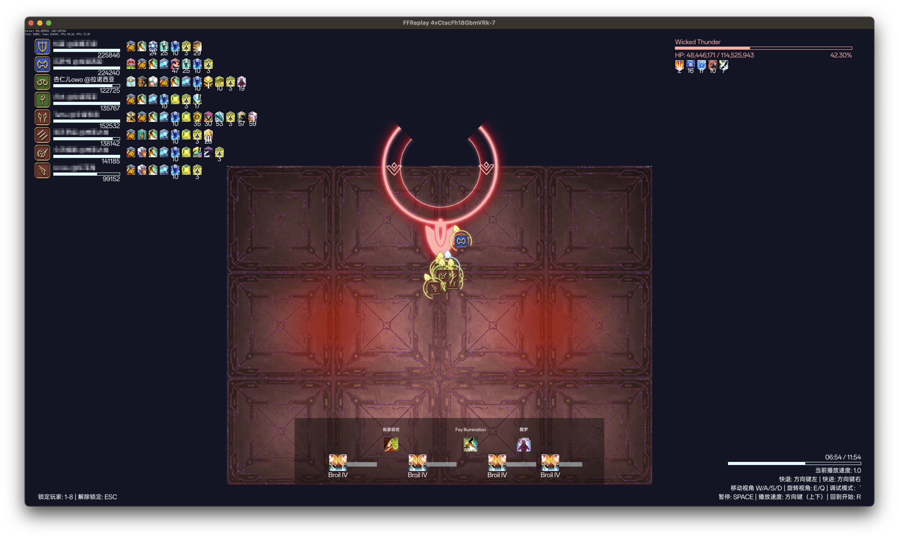

# FFXIV Replay



## Playground 战术板

网页首页选择 **Playground 战术板**，或在桌面运行 `go run cmd/ffreplay/ffreplay.go`。两者使用同一编辑器，不需要 FFLogs 账号或 `.credential`。

1. **布置场地。** 选择圆形或方形场地，可叠加副本底图、5 m 网格和 1 m 位置吸附。从左侧拖入队员、职业、标点、Boss、AoE、箭头或文字；也可以先点工具，再点场地放置。
2. **编辑站位。** 拖动对象移动；选中后的方块调整大小，金色圆点旋转，白点调整扇形开角、环形内径或直线宽度。右侧可以输入精确坐标、半径和角度，按 Enter 应用。Shift 点击可多选、一起移动或修改共有属性。
3. **编排步骤。** 用「复制步骤」接着画下一次机制，后续编辑不会改变前一步。也可插入空白步骤、重命名或删除步骤。右侧列表顶部是最上层；拖动一行，在金色插入线处松开即可排序，移出列表松开或按 Esc 可取消。也可用「上移」「下移」逐层调整。Delete 删除所选对象；Ctrl/Cmd+Z 撤销，Ctrl/Cmd+Shift+Z 重做。
4. **保存与分享。** 「保存草稿」保留一份当前方案，下次打开会恢复；未保存的修改不会自动写入草稿。网页草稿存在当前浏览器，桌面草稿在用户配置目录的 `ffreplay/draft.ffplan`。导出 `.ffplan` 可保留多份方案；网页使用下载，桌面写入当前工作目录。将文件拖入战术板即可导入。网页版还可点击「分享链接」后复制地址栏网址，无需上传；较大的方案请分享文件。

**与游戏互通：** 点击「导入游戏码」，网页版粘贴 `[stgy:a…]`，桌面版先复制再点击，也可以拖入只包含分享码的 `.txt` 文件。导入成功会打开一张新板，可撤销；失败不替换当前方案。「导出本步码」只导出当前步骤：网页从弹窗复制，桌面直接写入剪贴板。游戏限制每板 50 个元素（含线段）、8 段文字、板名最多 20 个 UTF-8 字节。游戏有自己的图标、缩放范围和 4:3 画布；底图只转换为游戏预设，头顶 Buff、自定义对象名称和连线绑定关系不会写入游戏码。保留完整多步方案请用 `.ffplan` 或 FFReplay 分享链接，而非游戏码或 `.xivplan`。

**连线：** 在「工具 → 连线」选普通、靠近、远离或磁极线型，依次点起点、终点。点对象会绑定并跟随移动；点空地则固定在该位置。点线段或用「选中下一条连线」可改色、换样式、删除。删除端点对象会一并删除关联线，重排对象图层不会改变绑定。游戏码中的线段只有坐标，导入后不会猜测它绑定了哪个对象。

「机制」「指示器」「敌方」「职能」分类中的扩充图标随应用分发，不依赖运行时外链。游戏格式与图形映射参考 [mogworks/xivplan 的 cn 分支](https://github.com/mogworks/xivplan/tree/cn/src/lib/strategy)，素材来源和权利声明见 [NOTICE](asset/strategy/NOTICE.md)。需要 Lua 沙盒时，网页版直接访问 `/ffreplay.html?sandbox`，桌面使用 `-sandbox` 或 `-script scripts/demo_basic.lua`。带 FFLogs 报告的启动方式仍进入回放。

画布下方的步骤条可以按名称跳转，也可用 Page Up / Page Down 切换。「补齐八人队伍」只添加缺少的 MT/ST/H1/H2/D1–D4，不移动已有队员。按 Alt 点击可轮选重叠对象；方向键移动 0.1 m，按住 Shift 移动 1 m。拖动中按 Esc 会还原整组位置而不占用撤销记录。属性输入按 Enter 或移出焦点提交，Esc 放弃输入。左下角显示草稿是否有未保存更改；导出、分享和浏览步骤不会覆盖草稿。窄窗口通过顶部「工具 / 对象 / 方案」切换面板，收起后可使用整块画布。

**头顶 Buff：** 单选一个职业或 MT/ST/H1–D4 队员，在「对象属性」点「头顶 Buff」。可按中文名称或图标 ID 搜索；点击图标添加，再点一次移除。每人每步最多 8 个，按添加顺序从左到右显示在角色上方。这些是静态机制标注，不会倒计时；复制步骤、撤销、草稿和分享都会保留列表。

## 游戏内长度和像素的换算

1000 pixel = 40m

也就是游戏内 1m = 25 pixel，在添加地板素材时，请根据这个比例进行缩放。左上角显示的鼠标位置，以场地中心为原点，向右为 x 轴正方向，向下为 y 轴正方向，单位是 pixel（不随缩放变化）。

## 运行和构建

### Temporary WorldMarker API

由于 FFLogs GraphQL API 未提供标点数据，所以需要一个临时的 API 用于获取标点数据，获取的方式比较粗暴；这个 API 会在后续版本中移除（如果 FFLogs GraphQL 提供了的话）。

```bash
CGO_ENABLED=0 GOOS=linux GOARCH=amd64 go build -o markerserver ./cmd/apiserver/apiserver.go
```

应将 `internal/data/markers/markers.go` 中的 `MARKER_ENDPOINT` 常量替换为 WorldMarker API 的地址。

### FFReplay

需要配置环境变量 `CREDENTIAL`，内容与 [本地调试运行](#本地调试运行) 中的 `.credential` 文件一致。

运行构建脚本生成 WASM 版本：

```bash
sh build.sh
```

具体构建执行的过程可以查看 `build.sh` 文件，构建完成后会在 `./public` 目录下生成静态文件，可以直接部署到服务器上，或是本地启动 http 服务查看。

构建产物分为两部分：`public/asset/` 下的图片与数据资源，以及按提交哈希 + wasm 内容哈希命名的 wasm 分块。资源文件不再打包进 wasm，而是单独提供；构建时会根据资源内容生成版本号，浏览器请求资源时自动附加 `?v=<hash>`，内容未变化时缓存可以跨版本复用，内容变化时 URL 随之变化，因此 `/asset/` 可以配置长缓存（例如 `Cache-Control: public, max-age=31536000`）。其中技能图标会在构建时拼接成单个自包含的图集文件 `public/asset/abilities/atlas-v1.bin`（图标索引和图集图片在同一个文件里，不会出现索引与图片版本不一致；文件名带格式版本，格式升级时换新文件名，旧缓存不会干扰），浏览器版本只加载这一个文件再按索引切分使用。浏览器端资源请求失败会重试，纹理加载失败时降级为占位纹理，不会中断回放。`ffreplay.html` 是 wasm 分块 URL 的入口，应使用较短缓存或 `no-cache`，部署后确保它被刷新。桌面版本仍将资源嵌入二进制，通过 `go run` 运行时不依赖这些静态文件。

### 本地调试运行

首先需要 FFLogs API 所需的 ClientID 及 ClientSecret（获取方式见[官方说明](https://cn.fflogs.com/api/docs)），然后在项目根目录下创建一个 `.credential` 文件，内容如下：

```text
CLIENT_ID:CLIENT_SECRET
```

然后即可运行：

```bash
go run cmd/ffreplay/ffreplay.go -u FFLOGS_URL
# or
go run cmd/ffreplay/ffreplay.go -r REPORT_CODE -f FIGHT_ID
```

## 项目结构

该项目使用 `ebiten` 游戏引擎开发，主要原因是支持编译为 WASM，能够直接在浏览器中运行；整体架构为 ECS（Entity-Component-System），请务必熟悉这个概念。

## 数据来源

- [FFLogs](https://www.fflogs.com/)
- [ffxiv-datamining-cn](https://github.com/thewakingsands/ffxiv-datamining-cn)
- [GarlandTools](https://www.garlandtools.org)
